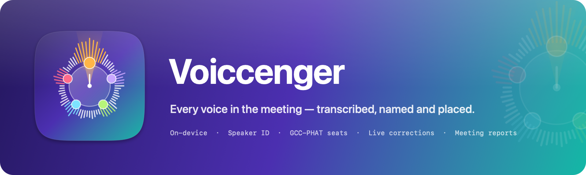

# Voiccenger

macOS 26 meeting transcriber. Detects meetings, records, transcribes live with accent-robust voice models, identifies who is speaking (enrolled voices, including similar ones), estimates seat direction with a mic array, lets each person tune recognition to their accent, flags speech slips with proposed corrections and suggestions, and writes a post-meeting report.

## Install
Download the latest `Voiccenger-x.y.z.dmg` from [Releases](https://github.com/ayoinc/Voiccenger/releases/latest), open it and drag Voiccenger to Applications. Builds are signed with Developer ID and notarized by Apple. Installed copies update themselves (**Voiccenger › Check for Updates…**, or automatically from Settings › General › Updates).

## Requirements
- macOS 26 on Apple silicon, Apple Intelligence enabled (on-device engine).
- Swift 6.2+ (Command Line Tools are enough; Xcode not required).
- Optional: Anthropic API key (Claude engine), USB mic array (ReSpeaker 4/6-mic, miniDSP UMA-8) for seat direction.
- Disk: Cohere Transcribe 2.2 GB and/or Whisper Large v3 Turbo 1.7 GB, downloaded on first use.

## Voice models and accents
Apple's recogniser has a single English acoustic model: the en-US, en-GB and en-ZA locales gave byte-identical transcripts on every test speaker, and there is no Nigerian, Ghanaian or Kenyan English locale. So, like [Superwhisper](https://superwhisper.com/docs/models/voice), Voiccenger runs dedicated speech models on-device and lets you pick one (Settings › Voice Models):

| Voice model | Role | Size | Languages |
|---|---|---|---|
| Cohere Transcribe (FluidAudio, Neural Engine) | Default: most accurate on accented English | 2.2 GB | 14 |
| Whisper Large v3 Turbo (WhisperKit) | Alternative; languages Cohere lacks (Swahili, Yoruba, Hausa, Amharic, Somali, Afrikaans…) | 1.7 GB | 99 |
| Apple Speech | Instant grey preview while someone talks; fallback while a model downloads | built in | per locale |

Live, Apple shows words instantly; each finished stretch of speech is re-transcribed by the selected model and replaces the preview.

**Benchmark.** 89 speakers from the [Speech Accent Archive](https://accent.gmu.edu/) (54 African: Yoruba, Igbo, Hausa, Ewe, Ga, Fante, Twi, Krio, Mende, Wolof, Bambara, Swahili, Luganda, Luo, Kikuyu, Somali, Oromo, Amharic, Tigrinya, Shona, Sesotho, Zulu, Tswana, Afrikaans, Lingala…) reading the same paragraph. Word error rate, lower is better:

| Speakers | Apple | Parakeet v3 | Voiccenger + Whisper | Voiccenger + Cohere |
|---|---|---|---|---|
| All 89 | 10.2% | 9.1% | 5.7% | **5.1%** |
| African (54) | 10.1% | 8.0% | 5.1% | **4.3%** |
| West African (34) | 9.5% | 6.5% | 4.9% | **3.4%** |
| East/Southern African (20) | 11.1% | 10.5% | **5.5%** | 5.7% |
| Native English (8) | 1.3% | 1.1% | **0.5%** | 0.9% |

"Voiccenger +" columns are measured through the app's own transcription path (`voiccenger-cli transcribe --engine …`). Running the models on whole clips does slightly better (Cohere 4.5% / 3.9% African; Whisper 5.1% / 4.1%), since the app splits audio at pauses.

Parakeet v3 drifted out of English for accented speakers (Dutch words, Greek script), so it isn't offered. No single model wins for everyone, which is why each person can calibrate.

**Make it yours** (People › person › Voice & Accent):
- **Calibrate**: read the Speech Accent Archive paragraph plus a sentence with your own name and a place you know. Every downloaded model transcribes it; the one with the fewest errors becomes yours, and mis-hearings become suggested corrections.
- **Accent background** and **lives in**: e.g. Nigeria and the United Kingdom. Every African country is listed; regional names, cities, institutions and currency (e.g. Olúwaseun, Ikeja, GTBank, naira) are added to the vocabulary.
- **Language** (any your model supports), **spelling** (British/American), **vocabulary** and **replacements** ("heard → meant").
- In meetings, each recognised person's turns are re-transcribed with their model and customised with their settings.

## Build, test, run
```sh
swift scripts/MakeFixtures.swift          # synthetic test audio → .fixtures/
scripts/test.sh                           # all suites (adds swift-testing plugin path for CLT)
VOICCENGER_INTEGRATION=1 scripts/test.sh --filter VCPipelineTests.FixturePipelineTests   # end-to-end
scripts/bundle.sh && open dist/Voiccenger.app
```
First run downloads FluidAudio speaker models from Hugging Face and may download Speech locale assets.

CLI (`swift run voiccenger-cli --help`): `devices`, `detect [--watch]`, `enroll <name> <wav> [--accent ng] [--lives gb] [--engine whisper] [--standard|--text file]`, `profiles`, `models [download|delete <engine>]`, `transcribe <file> [--engine cohere|whisper|apple] [--language en]`, `calibrate <wav> [--standard|--text file|--name N --region ng]`, `process <file> [--engine cohere] [--intelligence apple|claude] [--spelling british] [--truth json] [--out report.md]`, `doa`, `system-audio`.

## Releasing
Every push and pull request runs **CI** (`.github/workflows/ci.yml`): build, tests, and an unsigned DMG artifact.

Releases are cut with the **Release** workflow (`.github/workflows/release.yml`): Actions › Release › Run workflow, pick `patch`/`minor`/`major` (or type an exact version), optionally mark it a pre-release. Same from the terminal:
```sh
gh workflow run release.yml -f bump=minor
```
Pushing a `vX.Y.Z` tag releases that version too. The workflow:
1. picks the version (latest `v*` tag + bump) and build number (commit count, always increasing);
2. runs the tests;
3. builds the app with the version stamped into Info.plist, signs it with Developer ID (hardened runtime);
4. builds the drag-to-install DMG, notarizes and staples it;
5. signs the DMG for Sparkle (EdDSA) and writes `appcast.xml`;
6. tags the commit and publishes a GitHub Release with the DMG, its SHA-256 and the appcast;
7. **App Store** (non-pre-releases): builds the same version sandboxed and without Sparkle (`--disable-default-traits`), signs it with Apple Distribution, packages it with `productbuild` and uploads it to App Store Connect, where it appears in TestFlight. Submitting for review is done in App Store Connect.

The App Store variant differs only in: no Sparkle (the `Sparkle` package trait is off), App Sandbox entitlements (`Resources/Voiccenger-MAS.entitlements`: microphone, network client, user-selected files), an embedded provisioning profile, and a compiled asset-catalog icon (`Resources/Assets.xcassets`, needs Xcode's `actool`). Core Audio process taps and meeting detection work inside the sandbox. Data lives in `~/Library/Containers/com.voiccenger.app`.

Installed apps read `releases/latest/download/appcast.xml`, so only the newest non-pre-release is offered as an update.

Repository secrets:

| Secret | Purpose |
|---|---|
| `MACOS_CERTIFICATE_P12`, `MACOS_CERTIFICATE_PASSWORD`, `MACOS_SIGNING_IDENTITY`, `APPLE_TEAM_ID` | Developer ID Application certificate (base64 .p12) |
| `NOTARY_API_KEY_P8`, `NOTARY_API_KEY_ID`, `NOTARY_API_ISSUER_ID` | App Store Connect API key for `notarytool` |
| `SPARKLE_ED_PRIVATE_KEY` | Sparkle update-signing key; the public half is `SUPublicEDKey` in `Resources/Info.plist` |
| `MAS_APP_CERTIFICATE_P12`, `MAS_APP_CERTIFICATE_PASSWORD` | Apple Distribution certificate (App Store app signing) |
| `MAS_INSTALLER_CERTIFICATE_P12`, `MAS_INSTALLER_CERTIFICATE_PASSWORD` | Mac Installer Distribution certificate (signs the upload package) |
| `MAS_PROVISIONING_PROFILE`, `MAS_APP_APPLE_ID` | "Voiccenger Mac App Store" provisioning profile (base64); App Store Connect app ID 6822325105 |

Without the certificate/notary secrets the workflow still releases, ad-hoc signed. Losing the Sparkle private key means installed copies can no longer verify updates; a backup lives in the maintainer's login Keychain (`generate_keys --account voiccenger -x <file>` exports it).

Local equivalent of the pipeline:
```sh
# Pick the Developer ID identity by SHA-1 (`security find-identity -v -p codesigning`); names can be ambiguous.
export SIGN_IDENTITY=CE6B8B4871E09778C148588B5718F827ABAD63A0 VERSION=1.2.0
scripts/bundle.sh && scripts/make-dmg.sh dist/Voiccenger.app dist/Voiccenger-$VERSION.dmg
NOTARY_KEYCHAIN_PROFILE=voiccenger-notary scripts/notarize.sh dist/Voiccenger-$VERSION.dmg
```

## How it works
| Capability | Implementation |
|---|---|
| Online meeting detection | Core Audio process list: a known conferencing app/browser using the mic for ≥2 s starts, ≥5 s absent ends (`VCAudio.MeetingDetector`) |
| In-person detection | Energy VAD, ~30 s speech in 60 s (`ConversationDetector`), opt-in |
| Capture | Mic via AVAudioEngine; remote voices via Core Audio process tap on the meeting app — separate channels |
| Transcription | Apple `SpeechAnalyzer` streams a preview; utterances (joined across pauses < 3 s, ≤ 30 s) are re-transcribed by Cohere Transcribe or Whisper; Apple's word timings are transferred to the final text |
| Language/accent | Per-person calibration picks the best model; accent region seeds vocabulary; language switching (e.g. English ↔ French) on low confidence |
| Speakers | FluidAudio diarization + WeSpeaker embeddings; enrolled people matched by cosine with multi-sample profiles, ambiguity margin and per-cluster voting |
| Seat direction | GCC-PHAT steered response power over all mic pairs, per-speaker circular mean |
| Intent, corrections, suggestions | Apple Foundation Models (default) or Claude, per utterance. A correction is shown only as a self-correction, a contradiction of an earlier line or a likely mishearing, checked against the words spoken; filler or repetition clean-ups are never corrections |
| Report | Topics, decisions, action items (owner/due), notes, things that could have been said, open questions, corrections, per-person points; Markdown export with the voice model used. Every item cites numbered transcript lines and is kept only when those lines support it (shared content words, a commitment/request/decision/question cue, the owner as the committer or the person asked); per-person points cite that person's own lines, skip small talk and name nothing those lines don't; promises are never reported as done; only people with transcript lines appear; meetings with little substance get a brief report |

Data: `~/Library/Application Support/Voiccenger/`. Claude key stored in the Keychain.

## Measured
- Accented English (89 real speakers, see above): 5.1% word error rate with Cohere Transcribe vs 10.2% with Apple; 4.3% vs 10.1% for African speakers.
- Speaker attribution, 4 enrolled synthetic voices, 10-turn meeting: 10/10.
- Cohere warm-up ~11 s per launch on the Neural Engine (0.3 GB memory); Whisper ~1 s.
- DOA error at 20 dB SNR: ≤1° on presets.

## Limitations
- Cohere Transcribe supports 14 languages; for others (most African languages) choose Whisper, whose accuracy on them is lower than on English.
- Very short fragments re-transcribed in isolation can come back empty; the preview text is kept.
- Cohere occasionally completes a very familiar text from memory (seen on the benchmark paragraph); window boundaries are de-duplicated.
- Unenrolled similar voices can merge at the default clustering threshold (0.7); enroll people for reliable naming.
- Speaker labels lag ~10 s behind live text (diarization windows).
- Seat direction needs a multi-channel array; the built-in Mac mic can't localize.
- If system-audio permission is denied the tap yields silence, not an error.
- Report grounding is lexical: an item that shares words with its cited lines and has the right cue can still misread them. Long overview sentences are only checked for promises reported as done ("agreed on a budget freeze" for a feature freeze survives there).
- With CLT only, SwiftUI's `@State` macro is unavailable; views use a `ViewState = SwiftUI.State` alias.

## Artwork
Icon and banner are rendered in code: `swift scripts/MakeArtwork.swift` regenerates `Resources/AppIcon.icns`, the App Store icon catalog `Resources/Assets.xcassets`, the DMG background, `docs/icon.png` and `docs/banner.png`. The mark is a meeting table seen from above: waveform bars form the ring of seats, each speaker has a colour, and the beam points at whoever is talking.

## Privacy
See [PRIVACY.md](PRIVACY.md). Everything runs on-device except model downloads and the optional Claude engine.

## License
MIT — see [LICENSE](LICENSE). Uses [FluidAudio](https://github.com/FluidInference/FluidAudio) (Apache-2.0).
